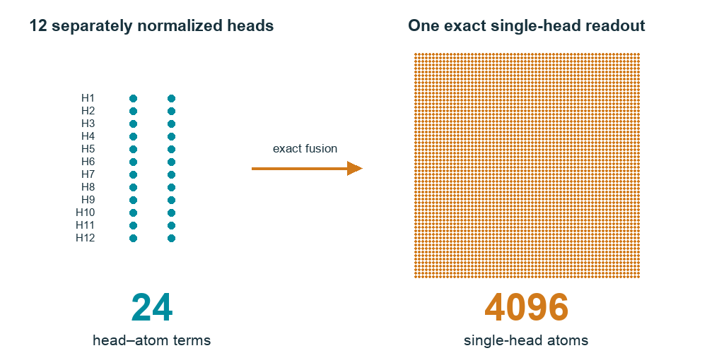

# Exact Fusion of Softmax Attention Heads Can Require Exponentially Many Atoms

Hiroyasu Usami · Keisuke Hara · Ayato Tsuboi · Naohiko Matsuda

[Main result](#main-result) · [Verify the certificate](#verify-the-certificate) · [Reproduce the experiments](docs/REPRODUCE.md) · [Citation](CITATION.cff)



## Main result

Replacing independently normalized attention heads by one softmax can require exponentially more explicit atoms. For the constructed family,

$$W_d(q)=\sum_{j=1}^{d}\sigma(q_j),\qquad M_{\min}(W_d)=2^d.$$

The original coordinate heads use `2d` head–atom terms. The single-head minimum is `2^d`, even when its query-independent keys, scalar values, and positive masses are jointly redesigned. The Cartesian construction attains this minimum.

## Verify the certificate

The finite-query rank-17 certificate can be checked with the **Python standard library**, without downloading model weights. From the repository root:

```sh
mkdir -p runs/proof
python3 certificate/portable_interval_minor17.py --input-npz certificate/certificate_input17.npz --output runs/proof/replay.json
python3 certificate/verify_stored_rank.py --enclosure runs/proof/replay.json --preconditioner certificate/ROOT_EXACT_RATIONAL_RANK_CHECK.json
```

The two expected states are `CERTIFIED_NONZERO_MINOR` and `PASS_EXACT_RATIONAL_RANK17`. This verifies the real-exponential vector map on 17 fixed queries; it is a separate result from the scalar exact-fusion theorem above.

## From the paper to the code

| Paper component | Implementation and archived artifacts |
| --- | --- |
| Controlled fixed-cache readouts, §VI-A | [`controlled/`](controlled/) — all 36 FP64 method/bank conditions |
| Native targets and scalar identity diagnostic, §VI-B | [`native/`](native/) — capture code, query bank, and reference results |
| Finite-query vector capacity, §VI-C and Appendix B | [`certificate/`](certificate/) — stored inputs and both verification programs |
| Learned approximation under equal byte budgets, §VI-D | [`learned/`](learned/) — fitting code, all starts, and frozen selectors |
| Calibration-query coverage, §VI-E | [`calibration/`](calibration/) — the second, disjoint 64-context bank and policy comparison |

[Reproduction instructions](docs/REPRODUCE.md) give the CPU and CUDA workflows. Exact dependencies are recorded in [`environment/`](environment/), external assets in [`assets/ASSETS.json`](assets/ASSETS.json), and frozen protocols in [`protocol_history/`](protocol_history/). Write new runs under `runs/` to preserve reference files.

The archived learned-cache comparisons retain the original mixed rankings: the prespecified two-budget superiority criterion was not met. Compare the complete results across budgets and calibration policies.

## Data, citation, and reuse

[CITATION.cff](CITATION.cff) records the manuscript title and authors. [MANIFEST.json](MANIFEST.json) records file hashes. Input banks retain the attribution and CC BY-SA 3.0 conditions in [DATA_ATTRIBUTION.md](DATA_ATTRIBUTION.md); model weights are obtained separately. See [THIRD_PARTY_NOTICES.md](THIRD_PARTY_NOTICES.md) and [LICENSE_STATUS.md](LICENSE_STATUS.md) for reuse terms. An author-owned code license has not yet been assigned.
